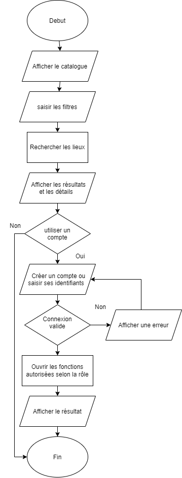
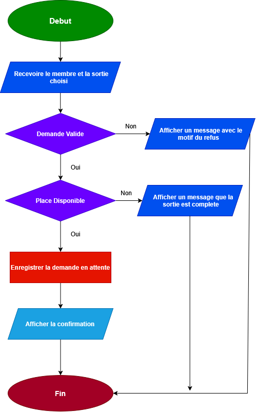

> [!Warning]
> les soumission ne doivent pas etre utilisé comme reference de devlopement
# Turisty - Informations general
## Présentation du projet
Turisty est une application Web en Python pour découvrir Montréal et organiser un séjour ou une sortie selon son budget et ses intérêts. Les touristes, les nouveaux arrivants et les étudiants pourront consulter des lieux, préparer un programme et rencontrer des personnes avec qui participer à des activités.

Les informations sur les activités, les restaurants et les hébergements sont souvent réparties sur plusieurs sites. Il faut comparer les prix et organiser les journées soi-même. Il n’est pas toujours facile non plus de trouver des personnes pour faire une activité ensemble.

Nous voulons regrouper ces possibilités dans une même application. Nous avons choisi ce sujet parce qu’il peut être utile aux personnes qui découvrent Montréal. Nous reprenons le projet présenté dans notre cahier des charges d’Analyse et modélisation.

## Utilisateurs visés et raison
- **Le visiteur** consulte les lieux et leurs détails sans avoir de compte. 
- **Le membre inscrit** prépare et sauvegarde un programme et demande à rejoindre une sortie.
- **L’organisateur** crée une sortie et accepte ou refuse les demandes. 
- **L’administrateur** gère les lieux, les utilisateurs et les contenus signalés.

## Fonctionnalités classées par priorité
### Priorité 1 - Consulter et rechercher des lieux
Afficher les activités, les restaurants et les hébergements de Montréal. L’utilisateur pourra filtrer les lieux selon son budget, ses préférences, la catégorie et la catégorie d’âge. Il pourra consulter la description, l’adresse et le prix estimé d’un lieu.

### Priorité 2 - Créer un compte et se connecter
Permettre à l’utilisateur de créer un compte puis de se connecter pour accéder aux fonctions réservées aux membres. Les mots de passe devront être enregistrés sous forme hachée.
### Priorité 3 - Préparer et sauvegarder un programme
Le membre indique son budget, ses intérêts, la durée du séjour, le nombre de personnes et la catégorie d’âge. L’application propose un programme d’un à trois jours avec un coût estimé et le budget restant. Le membre peut sauvegarder et modifier ce programme.
### Priorité 4 - Organiser des sorties collectives
Le membre peut créer une sortie en indiquant l’activité, la date, l’heure et le nombre de places. Les autres membres peuvent demander à participer. L’organisateur accepte ou refuse leurs demandes. Un chat lié à la sortie permet à l’organisateur et aux participants acceptés d’échanger pour préparer l’activité.

## Entrées traitements et sorties
### Recherche de lieux
Entrées : budget, préférences, catégorie et catégorie d’âge.

Traitements : vérifier les critères puis chercher les lieux correspondants dans le catalogue.

Sorties : liste des lieux trouvés et détails du lieu sélectionné.


### Compte utilisateur
Entrées : renseignements du compte et mot de passe.

Traitements : vérifier les champs, créer le compte ou vérifier les identifiants.

Sorties : confirmation, accès au compte ou message d’erreur.

### Programme personnalisé
Entrées : budget total, intérêts, durée de un à trois jours, nombre de personnes et catégorie d’âge.

Traitements : vérifier les entrées, proposer des lieux et calculer le coût total et le budget restant.

Sorties : programme par journée, coût estimé et confirmation de sauvegarde.
Sorties et chat de groupe

### Sorties et chat de groupe
Entrées : activité, date, heure, nombre de places, demande de participation et message.

Traitements : créer la sortie, vérifier les places, enregistrer la demande et appliquer la décision de l’organisateur. Vérifier l’accès au chat avant d’enregistrer un message.

Sorties : sortie publiée, demande en attente, réponse de l’organisateur et messages du groupe.

### Signalements et administration
Entrées : contenu signalé et action choisie par l’administrateur.

Traitements : enregistrer le signalement et vérifier les droits avant une modification.

Sorties : confirmation du signalement ou contenu mis à jour.

## Organigramme general du projet



## Algorithme de reservations

Entrées:
  - Le membre et la sortie choisie
  - Les informations nécessaires pour vérifier la demande
  - Le nombre de places et les participants acceptés

**Traitement:**
  - Vérifier la validité de la demande et les places disponibles.
  - Enregistrer la demande en attente si les conditions sont respectées.

**Sortie:** 
  - Une confirmation, un motif de refus ou le message « Sortie complète ».

```rs
DEBUT
    Recevoir le membre et la sortie choisie

    Vérifier si la demande est valide

    SI la demande est valide ALORS
        Vérifier si une place est disponible

        SI une place est disponible ALORS
            Enregistrer la demande en attente
            Afficher la confirmation
        SINON
            Afficher « Sortie complète »
        FIN SI

    SINON
        Afficher le motif du refus
    FIN SI
FIN
```


## Cas de test du premier prototype
### Test 1 Cas normal
Entrées : Membre B connecté; sortie de deux places avec un participant accepté.

Résultat attendu : La demande du membre B est enregistrée en attente. Le nombre de participants acceptés reste égal à un.

Résultat obtenu : conforme.

### Test 2 Cas limite
Entrées : Membre B connecté; sortie d’une place avec un participant accepté.

Résultat attendu : Le message « Sortie complète » apparaît. Aucune demande n’est ajoutée.

Résultat obtenu : conforme.

### Test 3 Cas invalide

Entrées : Membre B connecté; sortie inexistante.

Résultat attendu : Le message « Sortie introuvable » apparaît.

Résultat obtenu : conforme.
